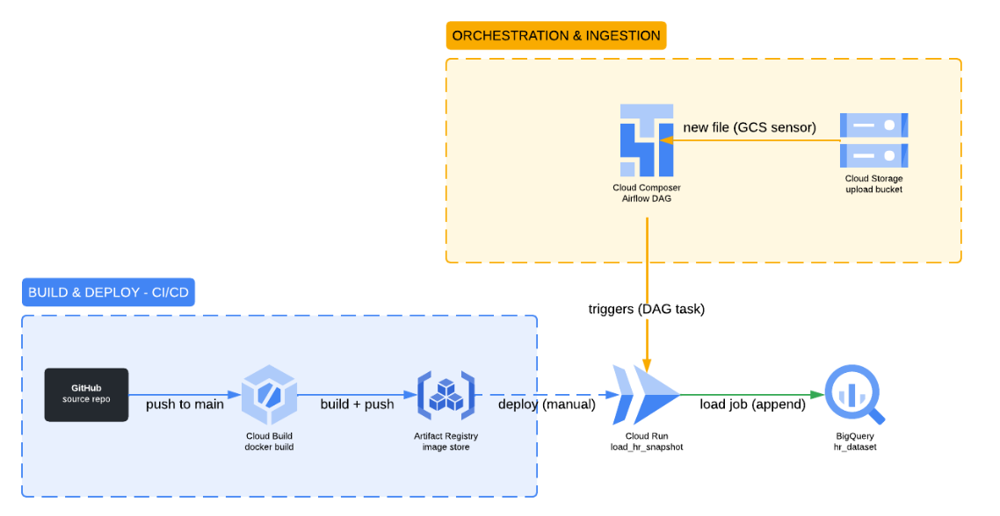

# HR Snapshot Pipeline — GCS + Cloud Run, orchestrated by Airflow

**Author:** Aeljirai

A small, production-style data pipeline on Google Cloud: an Airflow DAG
running on Cloud Composer triggers a private Cloud Run function, which
loads `fct_hr_snapshot.csv` from a GCS bucket into the BigQuery table
`hr_dataset.fct_hr_snapshot_unpartitioned`.



```
GCS bucket (fct_hr_snapshot.csv)
   ↑ read by
Cloud Run function (main.py: load_hr_snapshot) ← HTTP POST + ID token
   ↑ triggered by
Airflow DAG (dags/hr_snapshot_pipeline_dag.py), on Cloud Composer
         → BigQuery load job (append into fct_hr_snapshot_unpartitioned)
```

## Design choice: Airflow (pull) instead of Eventarc (push)

A GCS → Eventarc trigger would run the function automatically every time
a file lands in the bucket. That **push** model is the simplest wiring
for a single file arriving once.

I chose a **pull** model instead: Airflow decides when the function runs
(daily schedule, or a manual "Trigger DAG"). Nothing watches the bucket —
the function reads whatever is at `gs://.../fct_hr_snapshot.csv` when it
is called. Push reacts to data arriving; pull reacts to a schedule or a
human. Most orchestrated pipelines use pull because it is easier to
retry, backfill and chain after other tasks.

## Project layout

```
.
├── README.md
├── architecture_new.png
├── main.py            <- Cloud Run function: load_hr_snapshot (HTTP-triggered)
├── requirements.txt
├── Dockerfile
├── cloudbuild.yaml    <- builds the image and pushes it to Artifact Registry
└── dags/
    └── hr_snapshot_pipeline_dag.py   <- Airflow DAG that triggers the function
```

## Prerequisites

- A GCP project with billing enabled and the `gcloud` / `bq` CLIs installed.
- The BigQuery table `hr_dataset.fct_hr_snapshot_unpartitioned` must
  already exist — the function only appends to it.
- A Cloud Composer environment to run the DAG (examples below use
  `your-composer-env` in `europe-west9`).

## Setup

Replace `your-project-id` below with your real project ID everywhere
`main.py` picks up the project automatically (or from a `PROJECT_ID` env
var), and the DAG reads the Cloud Run URL from an Airflow Variable (step 6),
so no project-specific values live in the code.

### 1. Enable the APIs

```bash
gcloud services enable run.googleapis.com artifactregistry.googleapis.com \
  storage.googleapis.com cloudbuild.googleapis.com \
  --project=your-project-id
```

### 2. Create the Artifact Registry repo and the upload bucket

```bash
gcloud artifacts repositories create hr-pipeline \
  --repository-format=docker \
  --location=europe-west9 \
  --project=your-project-id

gcloud storage buckets create gs://your-project-id-hr-uploads \
  --location=europe-west9 \
  --project=your-project-id
```

### 3. Build the image and push it to Artifact Registry

`gcloud builds submit` runs as the **Cloud Build service account**
(`{PROJECT_NUMBER}@cloudbuild.gserviceaccount.com`). On recent projects
this account no longer gets the Editor role automatically, so grant it
the permissions it needs:

```bash
PROJECT_NUMBER=$(gcloud projects describe your-project-id --format='value(projectNumber)')

gcloud projects add-iam-policy-binding your-project-id \
  --member="serviceAccount:${PROJECT_NUMBER}@cloudbuild.gserviceaccount.com" \
  --role="roles/artifactregistry.writer"

gcloud projects add-iam-policy-binding your-project-id \
  --member="serviceAccount:${PROJECT_NUMBER}@cloudbuild.gserviceaccount.com" \
  --role="roles/logging.logWriter"
```

```bash
gcloud builds submit --config=cloudbuild.yaml --project=your-project-id
```

This builds the image and pushes it to the `hr-pipeline` repo. Confirm
it landed:

```bash
gcloud artifacts docker images list \
  europe-west9-docker.pkg.dev/your-project-id/hr-pipeline \
  --project=your-project-id
```

### 4. Deploy the image to Cloud Run

```bash
gcloud run deploy load-hr-snapshot \
  --image=europe-west9-docker.pkg.dev/your-project-id/hr-pipeline/load-hr-snapshot:<TAG> \
  --region=europe-west9 \
  --no-allow-unauthenticated \
  --project=your-project-id
```

`cloudbuild.yaml` tags the image with `$SHORT_SHA`; use the tag shown by
the `images list` command above (or in the Cloud Build logs).

The service is private (`--no-allow-unauthenticated`): only callers
presenting a valid ID token, such as the DAG, can invoke it.

### 5. Grant permissions to the two runtime identities

Two identities are involved. By default both are the Compute Engine
default service account, but their responsibilities are distinct:

**a) Cloud Run runtime identity** — runs `main.py`, so it needs
BigQuery and GCS access:

```bash
PROJECT_NUMBER=$(gcloud projects describe your-project-id --format='value(projectNumber)')
RUNTIME_SA="${PROJECT_NUMBER}-compute@developer.gserviceaccount.com"

gcloud projects add-iam-policy-binding your-project-id \
  --member="serviceAccount:${RUNTIME_SA}" \
  --role="roles/bigquery.dataEditor"

gcloud projects add-iam-policy-binding your-project-id \
  --member="serviceAccount:${RUNTIME_SA}" \
  --role="roles/bigquery.jobUser"

gcloud storage buckets add-iam-policy-binding gs://your-project-id-hr-uploads \
  --member="serviceAccount:${RUNTIME_SA}" \
  --role="roles/storage.objectViewer"
```

**b) Composer service account** — runs the DAG task, so it only needs
permission to invoke the private Cloud Run service:

```bash
COMPOSER_SA="${PROJECT_NUMBER}-compute@developer.gserviceaccount.com"

gcloud run services add-iam-policy-binding load-hr-snapshot \
  --region=europe-west9 \
  --project=your-project-id \
  --member="serviceAccount:${COMPOSER_SA}" \
  --role="roles/run.invoker"
```

Composer needs no BigQuery role: it only POSTs to the function, which
does the BigQuery work under its own identity.

### 6. Upload the DAG

```bash
gcloud composer environments describe your-composer-env \
  --location=europe-west9 --project=your-project-id \
  --format="value(config.dagGcsPrefix)"

gcloud storage cp dags/hr_snapshot_pipeline_dag.py gs://<dags-bucket>/dags/
```

Composer picks up new DAGs within a minute or two.

Then store the Cloud Run URL as an Airflow Variable named
`hr_snapshot_function_url`, either in the Airflow UI (**Admin → Variables**)
or from the CLI:

```bash
FUNCTION_URL=$(gcloud run services describe load-hr-snapshot   --region=europe-west9 --project=your-project-id --format='value(status.url)')

gcloud composer environments run your-composer-env   --location=europe-west9 --project=your-project-id   variables set -- hr_snapshot_function_url "$FUNCTION_URL"
```

### 7. Run the pipeline

Upload the source file to the bucket:

```bash
gcloud storage cp fct_hr_snapshot.csv gs://your-project-id-hr-uploads/
```

Then in the Airflow UI (Console → **Composer** → your environment →
**Open Airflow UI**), find `hr_snapshot_pipeline`, toggle it **On** and
click **▶ Trigger DAG**.

Verify the load:

```bash
bq query --use_legacy_sql=false \
  'SELECT COUNT(*) FROM `your-project-id.hr_dataset.fct_hr_snapshot_unpartitioned`'
```

The first load inserts 1179 rows. Re-running the DAG on the same file
appends another 1179 rows, since `main.py` uses `WRITE_APPEND` to keep
the function simple.

Monitor a run with `gcloud run services logs tail load-hr-snapshot --region=europe-west9`
(Cloud Run side) and the task logs in the Airflow UI (DAG side).

## Possible improvements

- Make loads idempotent (e.g. `WRITE_TRUNCATE` on a partition, or a
  staging table + `MERGE`) so re-runs don't duplicate rows.
- Pass the bucket/file name as a request parameter instead of hard-coding it.
- Archive or rename processed files after a successful load.
